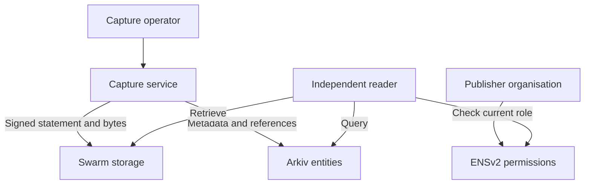

# Recall

**Preserve public webpages. Independently verify the integrity of every saved version.**

Recall is a proposed, open-source tool for preserving a specific version of a public web page and verifying the saved artifact after the original page changes or the Recall capture service disappears.

> **Project status: design and implementation specification.** No Recall application, repository, deployment, smart contract, capture, proof, test, licence file, demo or sponsor qualification is claimed by this README. Commands and paths labelled *planned* describe the intended implementation and must be updated after code exists. Deployment values and actual results must be filled in by the team.

## The problem

Public notices, application deadlines, policies and online reports can change or disappear. A person who relied on an earlier version may have only a screenshot or a broken link. They need an easy way to retain a specific version, find it later, and understand what can actually be verified about it.

Recall's initial user is a **student tracking a university admission or scholarship notice**, with researchers and other applicants as future users. The immediate benefit: retain the exact saved version they relied on, compare it with a later capture, and share a receipt explaining what can be checked. The MVP uses a team-controlled fixture rather than asserting a real institution changed a notice.

**Example:** a university publishes an application deadline of 15 December. After a capture, the notice changes to 12 December. Recall's timeline lets a reader retrieve the earlier saved version and verify that it matches the published capture statement.

## What Recall provides

1. A public HTML notice is captured through a restricted capture service.
2. The service hashes the exact saved bytes and produces an operator-signed capture statement.
3. The artifact and signed statement are stored on Swarm.
4. Public metadata and the Swarm references are published as an Arkiv entity.
5. A separately runnable reader queries Arkiv, retrieves the files from Swarm and verifies the byte hash and signature locally.
6. If the original Recall capture backend is unavailable, an independent reader can still verify **already published** captures, provided the required network data remains available.
7. A notice timeline and readable text diff help a user understand changes between two independently saved versions. A shareable receipt links the records and states the outcome of the actual checks.
8. ENSv2 can provide an organisation-controlled publisher name and delegated publishing permissions. The application must actually enforce those permissions in the publishing path.

### What is verified

| Reader result | Meaning | Does not establish |
|---|---|---|
| **Integrity verified** | The downloaded bytes match the SHA-256 digest in the signature-verified statement | That the original website served those bytes |
| **Signature verified** | The configured expected signer signed the canonical statement | That the signer is honest or represents the named organisation |
| **On-chain commitment found** | A verified Arkiv chain event contains the artifact digest and statement reference/digest being checked, no later than that event, subject to chain finality | That the page was captured at the operator-claimed time, or that the source served the bytes |
| **Source not independently proven** | The operator-attested baseline provides no portable proof that the claimed server served the bytes | A failed signature or failed artifact hash; show those separately |
| **Publisher permission currently active** | At a stated block, the configured ENSv2 authority currently grants the operator the relevant role | That the operator had the role at capture time, unless historical state is separately verified |
| **Reported observation** | A named checker reported an HTTP response or retrieval error at an indicated time | That a page is unavailable everywhere or that a checker is independent |

Each status must be shown separately as `pass`, `fail`, `unknown` or `not applicable`; do not collapse them into a generic green “Verified” badge. Only show an on-chain commitment as found after checking actual chain data against the relevant artifact digest and signed statement reference or digest; an indexer result alone is not a receipt proof. If event inclusion, chain/RPC state or matching fields cannot be checked, show `unknown`.

A signer and the reader may be independently operated, but **the operator-attested MVP still relies on the capture operator for its claim about the source and time**. A self-declared timestamp and the server's HTTP `Date` header are not independent trusted timestamps. A public chain record may establish that a submitted commitment existed no later than a particular chain event, subject to that chain's trust and time assumptions; it does not prove the asserted capture time or source.

### TLS proof: optional, gated enhancement

A portable TLSNotary proof could strengthen source attribution for supported requests, subject to the protocol, notary and verifier trust model. It is **not** an MVP claim. Before presenting it as functional, complete a real end-to-end spike with matching client/verifier versions, retain the actual proof artifact, verify it separately and document precisely which request/response bytes and server identity were verified. A signature by Recall on a transcript is **not** an independently verifiable TLS proof.

## Intended user experience

### Capture a notice

1. The operator chooses a permitted, public HTTPS URL or the team-controlled demonstration source.
2. Recall fetches a bounded response and shows the captured bytes, URL, status and any redirects for review.
3. The operator confirms publication and the licence/privacy implications of storing the material publicly.
4. Recall hashes the exact bytes and signs a canonical, versioned capture statement.
5. Recall uploads the artifact and statement to Swarm, then writes public discovery metadata to Arkiv.
6. The UI displays the Arkiv entity key, Swarm references, signer, and verification/trust status.

### Verify independently

1. A reader opens a separately hosted or locally run Recall reader.
2. The reader queries Arkiv for the record and reads the statement and artifact from Swarm.
3. It hashes the downloaded bytes and verifies the statement signature locally.
4. It displays the signer and the distinct trust statuses described above.
5. If the ENSv2 feature is complete, the reader checks the signer's **current** permission at an identified block and reports `active`, `revoked` or `unknown`. It does not silently label a historical capture invalid when current permission is revoked.

### Notice timeline and version comparison

The reader queries captures for the same source URL hash and publisher scope, shows source URL, artifact digest, signed claimed capture time and Arkiv publication information for each version, and lets the user select two. Default ordering is by chain publication position when available; show operator-claimed time separately because it may be inaccurate. Handle pagination, expired/missing records, unavailable indexers and incomplete result sets explicitly; never present an incomplete list as a complete history.

For each selected capture, retrieve the artifact and signed statement, verify the signature and exact-byte digest, then derive a readable text view using the same **versioned, deterministic extraction and normalization process**. Compare those derived text views side by side and highlight additions/removals, for example `Applications close on 15 December` → `Applications close on 12 December`. Label the diff as a derived view, display each version's integrity state and source links, and keep raw downloadable artifact bytes unchanged. A match in normalized text does not mean raw bytes or page behavior are identical. Reject comparison if integrity verification fails; when extraction is unsupported or incomplete, show that explicitly and offer the raw files.

The receipt contains both artifact hashes, signer and signature outcomes, capture-time claims, any checked chain publication evidence, Swarm references and retrieval status. It links to each capture so it remains usable as a shareable verification receipt, without stating that the source authenticity or original capture time was independently proven.

If a checker is implemented, show its result as an observation from that checker. A timeout, DNS error, rate limit or one 404 is not proof that the page is gone globally. A 451 is evidence only that a particular response was observed in that request context.

## Architecture



### Components

| Component | Responsibility | Trust or availability boundary |
|---|---|---|
| Capture service | Fetch a permitted source, hash exact bytes and sign a statement | The operator can misstate what was captured unless a separately verified source-proof path exists |
| Swarm | Store public artifacts and statements under retrievable references | Retrieval depends on available nodes/gateways, retained data and storage funding |
| Arkiv | Publish owner-controlled, queryable discovery metadata | Testnet, indexer/RPC availability and entity expiry remain dependencies |
| ENSv2 | Delegate a narrowly scoped publisher role and support current permission checks | Resolver/RPC availability, permission policy and cross-network timing must be handled |
| Independent reader | Query, retrieve, recompute hashes and verify signatures without Recall's capture API | Reader still depends on Arkiv, Swarm and any ENS RPC it uses |
| Optional TLS proof verifier | Verify a genuine, portable proof for a supported session | Must be integrated and evaluated separately; not part of the signed-claim baseline |

## Technology and intended layout

- **Reader:** React, TypeScript and Vite; locally runnable static app.
- **Capture service:** Node.js, TypeScript and Express; isolated, restricted outbound fetching.
- **Shared package:** versioned schemas, canonical serialization and signature/verification helpers.
- **Arkiv:** `@arkiv-network/sdk` or the currently documented JSON-RPC interface.
- **Swarm:** Bee API and a currently compatible JavaScript client.
- **ENSv2:** Permissioned Registry/Resolver and Enhanced Access Control on Sepolia; use the current ENS integration guides.
- **Tests:** a local controlled HTTP fixture plus integration tests for the actual selected SDK versions.

**Planned, not yet created:**

```text
recall/
├── apps/
│   ├── reader/                 # independent React reader
│   └── capture-api/            # restricted capture and publishing service
├── packages/
│   └── evidence/               # schemas, hashing, signing and verification
├── fixtures/
│   └── notice-server/          # controlled source for the demo
├── scripts/                    # deployment and reproducible verification
├── arkiv/
│   ├── schema.md
│   ├── friction.md
│   ├── reach.md
│   ├── why-arkiv.md
│   ├── how-you-use-arkiv.md
│   └── swarm.md                # required only when entering the Swarm bonus
├── README.md
└── LICENSE                     # create the chosen licence before submission
```

## Data design

### Artifact

For this MVP, accept a complete, bounded `text/html; charset=utf-8` HTTP response from a team-controlled allowlisted host. Request `Accept-Encoding: identity`; reject non-identity `Content-Encoding` rather than silently relying on HTTP client decompression. Hash and save the HTTP response **body bytes returned by the chosen client after transfer framing**, before character decoding, HTML parsing or normalization. These are application-level body bytes, not TLS wire bytes or HTTP headers. Record final URL, status, content type, content encoding and byte count in the signed statement. Configure and test the actual HTTP client so this representation is reproducible. Store these bytes separately from every readable preview or extracted text. Compute:

```text
artifact_digest = SHA-256(exact_artifact_bytes)
```

Do not treat a similarity hash, cleaned HTML, rendered screenshot or extracted text as equivalent to those bytes. Reject incomplete, truncated, oversized or unsupported captures. HTML-only capture does not preserve externally loaded CSS, JavaScript, images, embedded documents or dynamically fetched/rendered content; label the artifact **HTML response body only**, not a complete visual page. A browser-grade WARC/WACZ capture and broader encoding support are future work.

### Signed capture statement

The following is a proposed logical schema, not a wire-format guarantee:

```json
{
  "schemaVersion": "recall.capture.v1",
  "sourceUrl": "https://example.org/notice",
  "finalUrl": "https://example.org/notice",
  "httpStatus": 200,
  "contentType": "text/html; charset=utf-8",
  "contentEncoding": "identity",
  "captureRepresentation": "http-body-after-transfer-framing-before-text-decoding",
  "capturedAtClaimed": "2026-11-06T12:00:00Z",
  "artifactSha256": "<64-hex-character-sha256>",
  "artifactBytes": 1234,
  "captureMethod": "operator-attested-fetch",
  "publisherName": "<configured-ens-name-or-null>",
  "signerAddress": "<public-signer-address>",
  "signatureScheme": "eip712-recall-capture-v1",
  "signature": "<signature-over-typed-fields-excluding-signature>"
}
```

The signed message must bind every field above except `signature`, including `signerAddress`, `signatureScheme`, `contentEncoding` and `captureRepresentation`. The planned interoperable scheme is EIP-712 typed structured data with a versioned domain, network/chain binding and fixed field types; implement the exact domain, message type, string/byte encodings and validation rules once in `packages/evidence` and publish test vectors. Do not sign an ambiguous concatenation or include `signature` within the signed message. Pin the expected chain/domain and compare the recovered signer with the expected trusted signer. State whether the account supports EOA signatures only or also contract signatures. EIP-712 does not itself provide replay protection; identify the statement by its signed digest and make publication idempotent if duplicate publication matters. The examples are proposed, not generated test vectors. Recovery of an address establishes a signature relationship, not that a human-readable name is authentic.

### Arkiv `capture` entity

**Proposed indexed attributes:** `project`, `kind`, `sourceUrlHash`, `artifactSha256`, `publisher`, `claimedTime`, and `schemaVersion`, subject to the SDK's actual supported query types.

**Public payload:** original/final public URL, artifact Swarm reference, statement Swarm reference, signer address and required version information. Publish the artifact digest and a digest or exact reference to the signed statement in the entity/chain event so a reader can check the actual commitment against the retrieved record.

**MVP ownership:** the Recall capture-service writer wallet owns each Arkiv entity it creates; the organisation is represented separately by its ENS publisher name and the statement signer. The writer wallet is not the website owner or necessarily the student who requested capture. Entity ownership does not establish publisher authorisation. Record the actual owner wallet and entity key in the demo documentation. An organisation-owned writer is a future option, not a claim of the baseline.

**Primary query:** select captures by the same normalized public source URL hash and intended publisher scope; follow all pagination and sort deterministically by actual chain publication position. Show claimed capture time separately, and mark indexer omissions, expiry, pagination gaps or RPC errors as incomplete/unknown. Confirm that the chosen index and order operations exist in the actual Arkiv SDK; otherwise perform documented client-side sorting over a bounded complete result set.

- Use entity expiry configured for the demonstration; record the chosen duration.
- A hash of a predictable URL can still be guessed. Hashing is not access control.
- Never place credentials, private links, access tokens, private keys or encrypted Swarm references containing decryption keys in public entities.
- Treat retrieved URLs and all entity payloads as untrusted data.

### Optional `observation` entity

Only add this after capture and verification work. Record checker identity, request context, timestamp **as claimed by the checker**, result class and HTTP status where available. Keep `unreachable` separate from a server response. Display disagreements rather than computing a definitive takedown verdict.

## ENSv2 publisher permissions

**Target:** a publisher organisation grants an operator a narrow, revocable role under an ENSv2 name. The capture workflow verifies the specific configured role before publishing under that organisation's identity.

1. Create or control a test publisher identity on the supported ENSv2 Sepolia setup.
2. Use the current Permissioned Registry/Resolver and Enhanced Access Control interfaces to grant one narrowly scoped role to the operator.
3. Publish a record while authorised and expose the relevant name, role, signer and observed block in the reader.
4. Revoke that role and show a subsequent authorised-publishing attempt rejected.
5. Report `unknown` rather than `active` when the role lookup fails or is stale.

**Enforcement boundary:** ENS permission to edit a resolver record does not automatically grant or revoke the ability to create an Arkiv entity or sign a statement. The Recall publishing path must explicitly check the correct role and resource. Arkiv writes by unauthorised parties may still exist; independent readers must identify and label or filter them according to the stated policy. The team must implement and test how the role maps to a Recall publication action. A server-only check can be bypassed by direct Arkiv writes and must not be presented as network-wide enforcement.

**Cross-chain timing:** ENSv2 roles and Arkiv records are on different networks. Define what is checked at publication, handle RPC outages by failing closed, and make the observed block and finality assumptions visible. Without an independently verifiable historical role check at the relevant block, show **current permission only**, not `authorised at capture`. Revoking a role does not retroactively prove previous statements false.

### Publisher-management experience

Provide an administrator view of the configured publisher name, known operators, configured role/resource, current status and observed block, plus recent published captures. Grant/revoke controls must trigger real supported ENSv2 transactions and handle rejection or RPC errors. Build the operator list from the app’s registered operators and/or indexed events; it is not automatically an exhaustive list of all EAC role holders. Show `partial` or `unknown` when event indexing or enumeration is incomplete. This is a planned UI and must not be represented as built before it works.

Displaying a `.eth` name or pointing one to the frontend alone is not a meaningful ENSv2 permission demo.

## Swarm retention and artifact availability

The reader's receipt should display the actual Swarm reference, available postage batch ID and provider/owner, current retrieval result, last **observed** successful retrieval time, retention arrangement and estimated remaining batch TTL **only when the chosen Bee node/service can report it**. If unavailable, show `unknown`; a public gateway alone may not expose stamp metadata. A past successful retrieval does not guarantee current or future retrieval, and the reported batch TTL is an estimate, not a promise that every artifact remains available for that duration. Do not promise permanent storage or silently assume automatic funding/top-ups.

## Setup and prerequisites

### Current state

This README is a design deliverable. There is no checked-in application or tested setup command yet. Do not tell judges to run a nonexistent `npm install`, `npm run dev`, `docker compose up`, deployment script or query. Replace the following planned steps with exact commands, tested versions and actual outputs after the implementation exists.

### Accounts and tools to prepare

- Node.js and a package manager compatible with the versions actually selected by the team.
- Git and a public repository with a real open-source `LICENSE` file.
- An Arkiv Rabdi testnet wallet, test tokens and any required access key. Rabdi chain ID and endpoints are documented at [Arkiv docs](https://docs.arkiv.network/).
- A Swarm Bee node or suitable service, a usable postage batch and a way for the reader to retrieve the uploaded content. Record the batch ID, owner/provider and any service limits.
- An ENSv2-supported Sepolia RPC, testnet funds and a publisher name or other supported setup. Record the exact network, resolver, registry and role configuration used.
- A separate demo signer and securely held private key. Never put secrets into a frontend build, public repository, Arkiv or Swarm.
- A team-controlled public test notice with two known versions. Use fixtures with explicit permission to republish.

### Planned local startup sequence

1. Clone the finished public repository at the documented commit.
2. Install the exact locked dependencies selected by the team.
3. Copy the checked-in environment example and populate local values.
4. Start the controlled notice fixture, capture service and independent reader using their **actual** repository scripts.
5. Verify Arkiv connectivity, Swarm upload/read and ENSv2 role lookup independently.
6. Run the end-to-end capture and offline-reader checks described below.

### Environment contract

These variable names are proposed and must be aligned with the implemented code and `.env.example`:

| Variable | Where | Purpose |
|---|---|---|
| `ARKIV_RPC_URL` | capture/reader | Configured Arkiv RPC or indexer endpoint |
| `ARKIV_WRITER_PRIVATE_KEY` | capture server only | Entity-writing signer; secret |
| `SWARM_API_URL` | capture server | Bee/service API used to upload |
| `SWARM_BATCH_ID` | capture server | Usable postage batch identifier |
| `SWARM_GATEWAY_URL` | reader | Configured retrieval endpoint |
| `CAPTURE_SIGNER_PRIVATE_KEY` | capture server only | Signs capture statements; secret |
| `ENS_RPC_URL` | capture/reader | ENSv2-compatible Ethereum Sepolia RPC |
| `ENS_PUBLISHER_NAME` | capture/reader | Configured publisher identity |
| `ENS_REGISTRY_OR_RESOLVER` | capture/reader | Actual ENSv2 contract configuration, if needed by the implementation |
| `PUBLIC_CAPTURE_ALLOWLIST` | capture server | Explicit authorised demo hosts; not a substitute for network isolation |

Never prefix server secrets with a frontend public-variable prefix. Don't commit `.env` files or expose service keys in a downloadable reader. Record actual runtime variables and test their behavior before release.

## End-to-end demonstration

Use a controlled, explicitly labelled fixture. Replace example dates with the fixture's actual content.

1. Start a public HTTPS notice that says **“Deadline: 15 December.”**
2. Capture it through Recall, explicitly showing the original and final URLs and the `operator-attested` trust label.
3. Show the created Arkiv entity and the artifact/statement Swarm references.
4. Grant the operator a real ENSv2 publishing permission and show the authorised flow. If this integration is not ready, omit the claim and the ENS submission.
5. Change the source to **“Deadline: 12 December.”** Capture the new version and show a side-by-side derived text diff from the two independently saved, verified artifacts. Display their separate raw hashes and mark the diff as derived.
6. Stop the Recall capture backend.
7. Open a second reader served independently or run from a separately cloned checkout. Query Arkiv, retrieve the earlier bytes from Swarm, and verify hash and signature locally.
8. Modify the downloaded artifact and show the reader flag a hash mismatch.
9. Revoke the ENSv2 role and attempt a new publication. Show that the actual enforcing path rejects it; keep earlier records available and label current/historical status accurately.
10. Show limitations: signer trust, no independently proven source in the baseline, testnet, and live Arkiv/Swarm/ENS dependencies.

**Offline terminology:** `backend offline` means the Recall capture backend is stopped. It does not mean the reader is disconnected from the internet or that Arkiv, Swarm and Ethereum RPCs are unnecessary. Capture video with the actual working implementation, not simulated success screens.

## Security and privacy

### Capture and retrieval

- For the MVP, restrict captures to a team-controlled allowlist and authorised public fixtures. Production URL support requires a threat model and separate hardening.
- Reject local, loopback, link-local, private, metadata-service and internal network destinations, including IPv6 and alternate IP representations. Re-resolve and validate every redirect, protect against DNS rebinding and restrict egress at the network layer.
- Set response-size, redirect-count, content-type, timeout and concurrency limits. Reject unsupported or partial captures explicitly.
- Never capture authenticated pages, session cookies, private query parameters or other confidential material in the public MVP.
- Treat Swarm gateways, Arkiv data, source URLs, filenames and archived HTML as untrusted. Verify bytes against the separately obtained signed digest before use; do not assume a gateway response itself was verified merely because it came from a content-addressed service.
- Prefer safe text/download previews. If rendering untrusted HTML, use a sandboxed iframe with no script or same-origin permissions, restrictive CSP and no live external resource loads; avoid executing or trusting links in captured material.

### Signing and permissions

- Use a vetted signing library, deterministic encoding, domain separation and complete signed fields. Check recovered signer and expected organisation policy; never sign arbitrary client-submitted transcripts as verified captures.
- Keep signer keys and Arkiv wallet keys separate. Store secrets outside the client; rotate/revoke keys using a documented procedure.
- A valid signature shows a key signed a statement. It does not prove the signer is credible, the source returned the bytes, the text was accurate or an organisation approved the statement.
- `current`, `historically authorised`, `revoked` and `unknown` are different states. Never infer historical authorisation from a current ENSv2 role alone.

### Access and retention

- Public Arkiv entities and unencrypted Swarm content can be copied. Expiry or removal of a listing is not reliable deletion of copies.
- The reader sends queries to its configured Arkiv/indexer, Swarm gateway and ENS RPC. Those third parties may observe IP addresses, queries and timing. No analytics are planned; this is not an anonymity guarantee.
- Define who funds postage and what happens when a stamp or Arkiv entity expires. A content reference does not guarantee future retrieval.
- Preserve only content that the team is authorised to republish; use your own fixtures for the demo.

## CROPS

The following is the intended disclosure for the Ethereum Foundation track. Replace every planned statement with observed behavior before submission.

### C — Censorship resistance

Recall controls its capture service and any frontend hosting it operates. If the capture service disappears, **new captures through it stop**. Existing records should remain readable through an independent reader while the required Arkiv entities, Swarm artifacts and RPCs remain available. Demonstrate this by stopping the capture backend. Users can configure alternatives if the implementation actually supports them. The service does not guarantee that all gateways, network nodes or stored data remain reachable.

### O — Open source

The intended licence is MIT, subject to the team's choice and dependency compatibility. The repository must include the actual licence and complete instructions to run the reader from source. This design document alone is not open-source code or evidence that the project can currently be built.

### P — Privacy

The baseline reader should have no third-party analytics and should not call Recall's capture API. The configured Arkiv/indexer, Swarm gateway and ENS RPC may learn a reader's IP, queries and timing. The capture service can see requested URLs and operator network metadata. No blanket anonymity, confidential storage or deletion guarantee is made. Any private information must stay out of publicly replicated content.

### S — Security

The intended reader checks exact artifact hashes and statement signatures locally, presents signer/source trust separately, treats retrieved content as untrusted and supports a fail-closed permission check. The baseline does not independently establish original-server provenance or content truth. Key compromise, malicious operators, unsafe HTML, RPC compromise, incomplete capture and cross-chain state changes remain part of the threat model.

## Verification plan

### Unit and integration checks

| Test | Expected outcome |
|---|---|
| Change one byte of the saved artifact | Hash comparison fails |
| Alter a signed URL, digest, timestamp or status | Signature verification fails |
| Sign using a different key | Reader identifies an unexpected signer |
| Attempt to publish while unauthorised | The actual publishing enforcement rejects the action |
| Revoke a role after a legitimate capture | New publication fails; prior capture remains available with current role status shown separately |
| ENS RPC unavailable | Permission status becomes `unknown`; authorised publication fails closed |
| Stop Recall capture backend | An independently started reader can retrieve and verify an existing capture while external dependencies remain available |
| Arkiv/indexer or Swarm unavailable | Reader gives an explicit unavailable/incomplete result, not a verified badge |
| Source returns 404, times out or redirects | Each result is displayed as its observed category, not as a global takedown |
| Oversized, redirected or internal URL | Capture rejects it according to policy |
| Gateway returns changed bytes | Digest verification fails |
| Expired Arkiv entity or Swarm stamp | Reader reports missing/unavailable data without promising permanence |
| Two captured fixture versions have different deadline text | Timeline identifies both versions; derived diff shows removed and added dates while the original raw-byte hashes remain unchanged |
| Same rendered text, different raw bytes | Reader preserves distinct raw digests; normalized text equality is not a raw-byte match |
| Truncated, compressed or unsupported HTML | Capture rejects it or explicitly flags the unsupported state according to the policy, never claiming a complete capture |
| Claim of on-chain commitment with mismatching statement digest | Commitment check fails or remains unknown; no verified badge |
| Retention metadata unavailable | TTL and batch status show `unknown` while retrieval status reflects the actual attempt |
| Reader role list lacks complete indexing | Publisher-management UI labels the operator list partial/unknown |

Add real test commands, fixture names and observed results once the code exists. A table is a test plan, not evidence of passing tests.

## Sponsor submission checklist

Prize rules below were checked against the supplied briefs and official pages on 5 November 2026. Recheck the event's live requirements before submission. A pool is shared among winners; it is not a guaranteed award.

### Arkiv: Build on Arkiv, from scratch

- [ ] New project complies with ETHGlobal's from-scratch rules and disclosure requirements.
- [ ] A user-facing feature writes and reads entities on the current Arkiv testnet through the supported SDK or RPC.
- [ ] README contains actual writer wallet address(es) and a runnable query.
- [ ] `/arkiv/schema.md` states fields, query attributes, owner and expiry.
- [ ] `/arkiv/friction.md`, `/arkiv/reach.md`, `/arkiv/why-arkiv.md`, and `/arkiv/how-you-use-arkiv.md` answer the published criteria with real evidence.
- [ ] Public open-source repository includes licence and AI-use disclosure.

Pool: **$4,000**, with listed first place **$3,000** and second **$1,000**. An application must do more than write data that no feature reads.

### Arkiv + Swarm bonus, from scratch

- [ ] Use both Arkiv and Swarm in the actual product and select the bonus when submitting the relevant Arkiv track.
- [ ] `/arkiv/swarm.md` identifies what lives in each system and the entity field containing the Swarm reference.
- [ ] Include an actual entity key, accessible Swarm reference, postage batch ID, batch owner/provider and Bee node or service.
- [ ] Identify the real upload/read source files and reproducible upload/read steps.
- [ ] Record the demo-video timestamp and honest Swarm friction.
- [ ] Keep decryption-bearing encrypted references out of public Arkiv entities.

Bonus: **$500**, additional to a qualifying Arkiv track prize if awarded. It is not a separate partner selection under the published brief.

### Ethereum Foundation: Best CROPS App

- [ ] Publish a free and open-source repository with a real licence and runnable README.
- [ ] Include an accurate `CROPS` section covering control/dependencies, licence/build, third-party data exposure, keys/data and trust assumptions.
- [ ] Demonstrate the chosen resilience property end to end, including the moment the Recall backend is stopped.
- [ ] Include a demo video of no more than three minutes, and no third-party analytics/trackers in the client.
- [ ] Keep keys and personal data on the user's device or explain the exception as required.
- [ ] State the other trade-offs honestly and check the current status of any criteria marked pending review.

Pool: **$3,500**, with listed first place **$2,000**. The Foundation states a project can be placed in at most one of its tracks.

### ENS: Best Use of ENSv2

- [ ] Use ENSv2 on Ethereum mainnet or Sepolia, with working functionality central to Recall.
- [ ] Demonstrate a real scoped publisher permission, an allowed action and a revoked/denied action.
- [ ] Explain exactly which component enforces the permission and how an independent reader handles direct unauthorised Arkiv entries.
- [ ] Provide a live demo and public open-source source code; do not hard-code results or imply current role proves historical authority.

Pool: **$7,000**, with listed first place **$3,000**. An ENS name or contenthash alone should not be assumed to satisfy this track. The existing-project integration track has separate continuity rules and is not the default target here.

## Reproducibility and submission details

**To be filled from real deployments:**

| Item | Value |
|---|---|
| Public repository and commit | `TODO: actual URL and commit` |
| Live demo URL | `TODO: actual URL` |
| Demo video URL and Swarm timestamp | `TODO: actual URL and timestamp` |
| Arkiv writer wallet and entity key | `TODO: actual values` |
| Arkiv RPC and runnable query | `TODO: actual values and tested command` |
| Swarm artifact and statement references | `TODO: actual references` |
| Postage batch ID, provider/owner and Bee endpoint | `TODO: actual values` |
| ENSv2 network, publisher name, resolver, role and observed block | `TODO: actual values` |
| Independently runnable reader URL or commands | `TODO: actual values` |
| Tested Node/package versions | `TODO: actual values` |
| Known failures and unimplemented features | `TODO: observed results` |
| AI use and prior work disclosure | `TODO: truthful disclosure` |

Do not replace placeholders with invented values. The architecture, copy and configuration examples in this README were prepared before implementation; disclose relevant prior work and follow the event's current from-scratch rules.

## 36-hour implementation sequence

| Time | Milestone | Gate |
|---|---|---|
| 0–4 h | Real Arkiv write/read, Swarm upload/retrieval and one ENSv2 role spike if staffing permits | Record versions, references and failures; no success claim from SDK installation alone |
| 4–10 h | Allowlisted fixture capture, defined body-byte representation, SHA-256 and EIP-712 statement | One complete, operator-attested artifact and independently checkable signature |
| 10–16 h | Independent reader queries Arkiv, retrieves Swarm artifacts and verifies locally | Reader works with Recall capture API stopped, while showing remaining network dependencies |
| 16–21 h | ENSv2 scoped grant/revocation, publisher-management view and actual enforcement | By hour 21 demonstrate grant → allowed publication → revoke → denied publication; otherwise stop expanding ENS and omit that prize submission |
| 21–25 h | Notice timeline, two verified versions, derived readable diff, verification receipt and retention status | Deadline change is visible; raw artifacts stay unchanged; show `unknown` for unavailable metadata |
| 25–29 h | Backend shutdown, tamper, allowlist, SSRF restrictions and negative states | No false source-authenticity, historical-authority or global-takedown claim |
| 29–33 h | Deployment, reproducible commands and sponsor documentation | Replace placeholders with actual code, links and observed results |
| 33–36 h | Separate focused CROPS video of at most three minutes, remaining sponsor material and rehearsal | A working core takes priority over an unfinished third integration |

**Three non-negotiable milestones:** (1) capture, sign, publish, retrieve and verify one record; (2) independently retrieve and verify with the Recall backend stopped, including tamper rejection; (3) for an ENS submission, demonstrate real delegated permission, revocation and enforced denial. The third is a submission gate, not permission to sacrifice the first two.

A TLSNotary portable-proof spike is optional only after the team has owners for the core path. If it consumes the main integration window, ship the clearly labelled operator-attested baseline instead.

## Prior art and references

Recall builds on an existing web-archiving ecosystem. [Perma.cc](https://perma.cc/about) preserves citation pages, and [Scoop](https://tools.perma.cc/) produces portable web archives with signing support. The potential contribution here is a specific independent-reader workflow using the selected infrastructure, not the invention of signed web capture.

- [ETHGlobal Mumbai: Arkiv](https://ethglobal.com/events/mumbai/prizes/arkiv)
- [ETHGlobal Mumbai: Ethereum Foundation](https://ethglobal.com/events/mumbai/prizes/ethereum-foundation)
- [ETHGlobal Mumbai: ENS](https://ethglobal.com/events/mumbai/prizes/ens)
- [Arkiv documentation](https://docs.arkiv.network/)
- [Swarm documentation](https://docs.ethswarm.org/)
- [ENSv2 Enhanced Access Control](https://docs.ens.domains/ensv2/enhanced-access-control/)
- [EIP-712 typed structured signing](https://eips.ethereum.org/EIPS/eip-712)
- [Swarm postage stamps and retention](https://docs.ethswarm.org/docs/concepts/incentives/postage-stamps/)
- [TLSNotary extension and verifier](https://github.com/tlsnotary/tlsn-extension)
- [ETHGlobal rules](https://ethglobal.com/rules)

## Licence

**Planned:** MIT, subject to team approval and dependency review. Add an actual `LICENSE` file and replace this statement when the repository exists.
