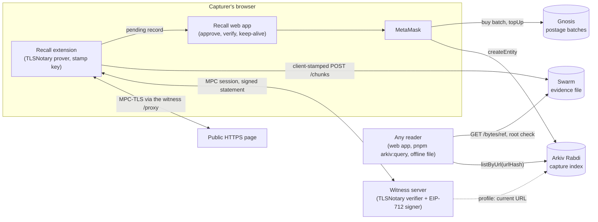

# Recall

**Prove what a public web page said on a given day. Anyone can check it without trusting the
person who captured it: you trust the witness key you pin, and by default that is ours.**

> **Judges: start here**
> - **See a verified capture (no install, no wallet):** open the capture in the app:
>   <https://localhostwastaken.github.io/Recall/app/#/c/0xc50021a907dbd1d511d2e4a1482614647cbbb4a0dd2d4bf26ad70065b3611244>
> - **Install the extension and capture a page yourself:** download `recall-extension.zip` from the
>   [v0.1.0-mumbai release](https://github.com/localhostwastaken/Recall/releases/tag/v0.1.0-mumbai), unzip it and "Load unpacked" in `chrome://extensions`
>   (steps under [Run it](#run-it)).
> - **The app on Swarm (browse and verify):** feed manifest
>   `e002e9ab0bee50f874a8ee461fe053aca71c7e3be502b941d8933008e357f9e0` (one address that survives
>   republishing). Open it through any Bee node at `/bzz/<feed manifest>/`, for example a read-only one
>   started by `bash scripts/swarm-reader.sh` at `http://127.0.0.1:1733/bzz/<feed manifest>/`.
>   bzz.link will serve it once the Swarm team allowlists the hash (requested). Details under
>   [The web app](#the-web-app).
> - **Run the Arkiv query:** `pnpm install && pnpm arkiv:query` (see [Writer wallets](#writer-wallets)),
>   or the keyless `curl` there.
> - **Arkiv prize docs:** [arkiv/](arkiv/): [schema](arkiv/schema.md), [how we use Arkiv](arkiv/how-you-use-arkiv.md),
>   [why Arkiv](arkiv/why-arkiv.md), [friction](arkiv/friction.md), [reach](arkiv/reach.md), [Swarm](arkiv/swarm.md).
> - **EF CROPS:** [## CROPS](#crops) and [## Limitations](#limitations).
> - **Every live value we measured:** [docs/evidence-log.md](docs/evidence-log.md).
> - **Built from scratch at ETHGlobal Mumbai 2026:** everything here was written at the hackathon,
>   except the vendored TLSNotary code (the `extension/` fork of tlsn-extension and the verifier in
>   `witness/`), whose upstream origin and our changes are listed in their NOTICE files.

Official notices and policies get quietly edited or taken down. Recall lets a journalist or
researcher capture a public HTTPS page so that anyone can later check, in a browser or fully
offline, what the page said:

1. **Capture.** The Recall browser extension fetches the page over TLS together with an
   independent **witness** (TLSNotary MPC-TLS). The witness never holds your keys, but it sees the
   full request and response, can tell that the bytes really came from that server, and signs a
   statement about them (EIP-712). Requests carry no cookies or login, because the witness refuses
   any that do.
2. **Store.** The signed evidence file (request, response, signature) goes to **Swarm**, stamped in
   your browser with a postage batch you paid for.
3. **Index.** A small record (which page, which body hash, which witness, when, where the evidence
   is) goes to **Arkiv**, written from your own MetaMask. Records the product writes are created read-only:
   nobody, not even the person who wrote one, can change its content later (our live demo records
   were written before that rule and are not read-only).
4. **Verify.** The Recall web app (or `pnpm arkiv:query`) finds every capture of a URL on Arkiv,
   downloads the evidence from any Swarm gateway, recomputes the Swarm hash, and re-runs every
   check itself: transcript hashes (A), the request and response (B), and the witness signature
   against the witnesses *you* trust (C). It shows a timeline of versions and a diff; our demo
   scenario is a university notice whose deadline moves from "15 December" to "12 December". A
   downloaded evidence file can be dropped into the app and verified with the network switched off.

Live: the app at <https://localhostwastaken.github.io/Recall/app/>, the demo notice at
<https://localhostwastaken.github.io/Recall/notice/>.

The app is also live on Swarm, so the verifier survives if GitHub Pages goes away:

- **Open it through any Bee node** at `/bzz/e002e9ab0bee50f874a8ee461fe053aca71c7e3be502b941d8933008e357f9e0/`.
  `bash scripts/swarm-reader.sh` starts a read-only one (ultra-light: no wallet, no funds) and prints
  `http://127.0.0.1:1733/bzz/e002e9ab0bee50f874a8ee461fe053aca71c7e3be502b941d8933008e357f9e0/`.
- **Feed manifest (the address to share):**
  `e002e9ab0bee50f874a8ee461fe053aca71c7e3be502b941d8933008e357f9e0`. It names a Swarm feed (owner
  `0x3c221Ba84864c187DaA72e9A861b20aAdE1F89C1`, topic `website`): the feed keeps one address across
  republishes by pointing at the current site, as in
  [docs.ethswarm.org/docs/develop/host-your-website](https://docs.ethswarm.org/docs/develop/host-your-website/).
  The site manifest it points at today is `7d1e73275798f6e0e69a08804bda4b582182e51456c41182637e8240cfad45a8`.
- **Storage:** postage batch `0x50c1a8d51231595606ea8730f14554c4cdbb5d64280e82063e9a24347dd1f3b9`
  (depth 18, 14 days, 1.276 xBZZ, paid by the treasury). Every transaction and value is in
  [arkiv/swarm.md](arkiv/swarm.md) and the [evidence log](docs/evidence-log.md).
- **bzz.link is not working yet:** <https://bzz.link/bzz/e002e9ab0bee50f874a8ee461fe053aca71c7e3be502b941d8933008e357f9e0/> and
  <https://bah5qcgza4abotkyl5zipq5fi5zdb7yctvstry7r34ublsqoysmyary2x7hqa.bzz.link/> show
  `/forbidden` until the Swarm team allowlists the hash; we have asked. Once it does, bzz.link
  serves the app.
- **The public download gateway serves the files, but as downloads.**
  download.gateway.ethswarm.org answers `/bzz/...` with `Content-Disposition: attachment`, so a
  browser saves `index.html` instead of showing the app.
- **Browse and verify only.** Capturing and publishing use the GitHub Pages app: the release
  extension accepts messages from the Pages app only.

## Demo

<!-- DEMO-VIDEO: link to the 3-minute video goes here -->
_Demo video: coming with the submission (3 minutes, link here)._

## Architecture



| Part | Where | What it is |
|---|---|---|
| Extension | `extension/` | Fork of [tlsn-extension](https://github.com/tlsnotary/tlsn-extension) 0.1.0.1501 with a "Capture this page" popup, the stamp key and the Swarm upload (`extension/packages/extension/src/recall/`) |
| Witness | `witness/` | TLSNotary's verifier server (tlsn `v0.1.0-alpha.15`) plus Recall's gates and EIP-712 signing patch ([witness/README.md](witness/README.md)) |
| Evidence | `packages/evidence/` | The evidence format, HTTP transcript parsing, canonical URL, and the checks A to D, shared by the extension, the app and the scripts |
| Network | `packages/net/` | Arkiv entities and queries, Swarm stamping and download, Gnosis postage batches |
| Web app | `apps/web/` | Browse, verify, approve (the MetaMask write), buy storage, keep-alive, settings. Static, hash-routed, no backend |
| Scripts | `scripts/` | Witness key and profile, funding, Swarm publish of the app, the docs check and the Arkiv query |
| Docs | `docs/`, `arkiv/` | Design and plan, the live evidence log, and the Arkiv and Swarm prize docs |

More detail: [arkiv/schema.md](arkiv/schema.md), [arkiv/how-you-use-arkiv.md](arkiv/how-you-use-arkiv.md),
[arkiv/swarm.md](arkiv/swarm.md), the design in
[docs/superpowers/specs/2026-11-06-recall-design.md](docs/superpowers/specs/2026-11-06-recall-design.md)
and every live value we measured in [docs/evidence-log.md](docs/evidence-log.md).

## CROPS

The lead property is censorship resistance of the evidence: once a page is captured, nothing Recall
runs is needed to find it, fetch it or check it.

- **C: Censorship resistance.** We run the witness (needed only for new captures; anyone can run
  another from `witness/`, and readers pin the keys they trust) and the GitHub Pages copy of the app.
  If either goes away, existing captures still verify from Arkiv, Swarm, any copy of the app (one is on Swarm) or an
  offline file, as long as the Arkiv record and the Swarm batch are paid for and the testnet runs.
- **O: Open source.** MIT ([LICENSE](LICENSE)); the forked TLSNotary code keeps its MIT/Apache-2.0
  notices. Extension, witness, app, scripts and the local devnet all build and run from this repo.
- **P: Privacy.** No analytics or trackers. The extension fetches the page once directly from your
  browser (without cookies) to check its size before capturing, so the site sees your IP once; the
  capture itself goes through the witness, which sees the page and your IP, and the site sees the
  witness's IP. The Cloudflare tunnel, Arkiv RPC, Swarm gateways, Gnosis RPC and GitHub Pages see
  your IP and what you ask them for (details under [Limitations](#limitations)). A record is public
  and names the wallet that wrote it.
- **S: Security.** Keys stay on the device (MetaMask; the stamp key in the extension; the witness key
  on the witness). You trust the witness you pin; gateways and RPCs can withhold data but not forge
  it, because every view recomputes the Swarm hash (except free-mode records, which rely on checks
  A–C plus the record cross-check) and re-runs the checks. tlsn alpha.15 is unaudited.

## Run it

**Needs:** Node 22, pnpm 10 (`corepack enable`), Docker, and Chrome or Chromium. For live captures:
MetaMask, a little tGLM on Arkiv Rabdi, and xBZZ plus xDAI on Gnosis.

```bash
pnpm install
```

### Verify without installing anything
Open <https://localhostwastaken.github.io/Recall/app/>, paste
`https://localhostwastaken.github.io/Recall/notice/?run=0tzgmo55` and open the capture. Or run the
query below (`pnpm arkiv:query`).

### Local devnet and tests
```bash
pnpm devnet:up         # Arkiv dev node :8545, Gnosis fork :9545, 3 Bee nodes :1633/:1643,
                       # TLS 1.2 notice fixture, witness :7047 (first run builds images; minutes)
pnpm test              # Vitest: packages, app and scripts against the devnet
(cd extension && npm install && RECALL_DEV_CA_DER_B64="$(base64 < ../fixtures/notice/.certs/ca.der | tr -d '\n')" npm run build)
pnpm test:e2e          # Playwright: extension + app journeys on the devnet (mock wallet)
pnpm check:docs        # the submission docs are complete (--final: no placeholders left)
pnpm devnet:down
```
Details: [devnet/README.md](devnet/README.md).

### The extension (live)
Download `recall-extension.zip` from the
[v0.1.0-mumbai release](https://github.com/localhostwastaken/Recall/releases/tag/v0.1.0-mumbai), or build the same thing yourself:
```bash
pnpm extension:zip     # release build (Mozilla roots, no dev hooks) -> dist/recall-extension.zip
```
1. Unzip it, open `chrome://extensions`, turn on Developer mode, "Load unpacked", pick the folder.
2. Copy the extension's ID from `chrome://extensions` into the app's **Settings > Extension ID**
   (the Storage page needs it to hand batches to the extension).
3. Funds: tGLM for Arkiv writes from <https://hub.arkiv.network/faucet>; xBZZ and a little xDAI on
   Gnosis for storage. There is no public xBZZ faucet: we used a Swarm booth gift, or ask the team.
4. Buy storage once on the app's **Storage** page: it offers 7 or 30 days (about 0.32 xBZZ per batch
   for 7 days at today's price, plus a tiny xDAI fee); each capture uses one batch.
5. Open a public HTTPS page that serves TLS 1.2 (the demo notice does), click the Recall icon, then
   "Capture this page". After the upload an approval tab opens in the app: connect MetaMask, let it
   add Arkiv Rabdi (chain 7794095), and publish.

### The web app
- Hosted: <https://localhostwastaken.github.io/Recall/app/> (live networks).
- On Swarm: feed manifest `e002e9ab0bee50f874a8ee461fe053aca71c7e3be502b941d8933008e357f9e0` (same build; see "Live"
  above), through any Bee node at `/bzz/<feed manifest>/` (`bash scripts/swarm-reader.sh` starts one
  at `http://127.0.0.1:1733`). Use it to browse and verify; capture and publish from the GitHub
  Pages app.
- From source: `pnpm --filter web dev` (local devnet) or `VITE_RECALL_NET=live pnpm --filter web dev`
  (live networks). A build is plain static files (`pnpm --filter web build`), so it can be served
  from anywhere, including Swarm: `pnpm publish:swarm --net live --feed` (that is how the copy above
  was published).

### Your own witness
Copy `.env.example` to `.env.local`, run `pnpm witness:keygen` (writes the key, prints only the
address), then `pnpm tunnel:up` (Docker witness plus a Cloudflare quick tunnel; needs `cloudflared`)
and `pnpm witness:announce --net live` (writes the witness profile on Arkiv; the witness wallet needs
a little tGLM, which the script tops up from your funding key). Readers add your address in Settings
to trust your captures. Extensions only accept a profile **created** by the witness key itself.

## Writer wallets

Every Arkiv entity this project wrote on **Arkiv Rabdi** (chain 7794095) came from one of these:

| Wallet | Role | Writes |
|---|---|---|
| `0xd46480d1Ec02B8ce92aE383914026efD5F73f835` | Treasury, and the capturer's wallet in our live runs (MetaMask / the mock wallet backed by its key) | `recall.v1.capture` records (and the P0 test rows) |
| `0xC9319e18e86cd7EB653c0Ed0693c0cf5B63db37D` | The Recall witness signer | `recall.v1.witness` profiles (its current URL); also the EIP-712 signer of every capture |

In the product, capture and confirmation records are written by whoever captures, from their own
wallet. No `recall.v1.confirmation` has been written on Rabdi yet (they are exercised on the local
devnet).

**Run a query** (reads Rabdi with `@recall/net` `listByUrl`, then downloads and verifies each
capture's evidence from Swarm):

```bash
pnpm install
pnpm arkiv:query
# or another page:
pnpm arkiv:query --url 'https://localhostwastaken.github.io/Recall/notice/?run=xbvmqf0p'
```

It checks the page's captures newest first until 5 verify A to C against the Recall witness, prints
each with signer, signedAt and evidenceRef, and counts the rows it rejected. It exits non-zero when
none verify. `ARKIV_ACCESS_KEY` (from the environment or `.env.local`) is used when set and never
printed; without it the public, rate-limited endpoint is used.

**Or with no tools but curl** (the public endpoint, no key; the `urlHash` is keccak256 of
`https://localhostwastaken.github.io/Recall/notice/?run=0tzgmo55`):

```bash
curl -s https://rpc.rabdi.db-chain.testnet.arkiv.network -H 'content-type: application/json' --data @- <<'EOF'
{"jsonrpc":"2.0","id":1,"method":"arkiv_query","params":["arkiv.schema = str('recall.v1.capture') AND urlHash = key(0x1dcb2cebcb3bd31e55a91320ca7523c83abc0faaad0b5b32c0cdd4ecce872540)",{"select":{"key":true,"owner":true,"creator":true,"expiresAt":true,"creationFlags":true,"attributes":{"witness":true,"signedAt":true,"evidenceRef":true,"batchId":true}},"limit":"0x5"}]}
EOF
```

It returns entity `0xc50021a9...3611244` with its `evidenceRef` and `batchId`. That record was
written before entities were made read-only, so it shows `"readonly":false`; records written from
now on show `"readonly":true`.

## Limitations

- **One witness.** Captures need the Recall witness (or another one someone runs). It currently runs
  on a laptop behind a Cloudflare quick tunnel (`cloudflared`), so captures stop when that laptop
  or tunnel is down. Verification does not need it.
- **tlsn alpha.15 is unaudited.** TLSNotary `v0.1.0-alpha.15` has had no security audit, and nor has
  our signing patch.
- **TLS 1.2 only.** The MPC-TLS in this tlsn version speaks TLS 1.2; sites that only offer TLS 1.3
  cannot be captured.
- **64 KB response cap, static HTML only.** A capture holds at most about 64 KB of response. What is
  captured is the HTML the server sent: pages that build their content with JavaScript capture
  nearly empty, and previews never run the page's JavaScript (sandboxed iframe).
- **About 77 MB of upload per capture.** MPC setup sends roughly 77 MB from the browser to the
  witness (measured: 77.0 MB in / 3.7 MB out). On a fast link a capture takes 5 to 30 s; on a slow
  link (a 5 Mbps venue uplink, in our case) it times out.
- **Testnet.** The index is on Arkiv **Rabdi**, a testnet. Swarm and Gnosis are mainnet.
- **Public gateway moderation.** By default evidence is uploaded and read through the public Swarm
  gateways (api/download.gateway.ethswarm.org, bzz.link), which can refuse or take content down. We
  met this ourselves: api.gateway and bzz.link redirect the HTML of a hash that is not allowlisted
  to `/forbidden`, and download.gateway.ethswarm.org sends `/bzz/` files as downloads, so for now
  our Swarm copy of the app opens through a Bee node of your own (`scripts/swarm-reader.sh`). Raw evidence bytes (`/bytes/<ref>`) were served by
  download.gateway and bzz.link. The data stays on Swarm while its batch is paid; any Bee node or gateway can be set in
  Settings.
- **The Arkiv access key ships in the client, by design.** It is a public rate-limit key baked into
  the app and extension builds (never committed); anyone can read it from the bundle, and it travels
  in the Rabdi URL path, so it shows in network logs. Users can replace it in Settings.
- **Who learns what.** The witness sees each captured page and your IP. The Cloudflare tunnel in
  front of it sees your IP, the timing and the server name you capture. The Arkiv RPC sees which URL
  hashes you look up; Swarm gateways see which evidence you fetch; the Gnosis RPC sees storage and
  keep-alive reads; GitHub Pages serves the app. All of them see your IP. A record is public and
  names its owner wallet, so a capture links that wallet to the page: use a fresh wallet if that
  matters.
- **Records are read-only, not undeletable.** Content can't be changed by anyone, and anyone can
  extend a record, but its owner can still delete it or transfer it (Arkiv has no flag against
  that). Records written before this rule (including the live demo capture above) are not
  read-only. The evidence on Swarm is unaffected by either.
- **A record's batchId is not cryptographically bound to its evidence.** The Swarm reference is
  bound (the root hash is recomputed), but the batch a record names could be any batch. The
  keep-alive therefore checks that the batch exists on Gnosis and has Recall's shape (immutable,
  depth 17 or 18) before anyone pays to top it up.
- **Storage lasts as long as someone pays.** A postage batch and an Arkiv record expire unless someone
  uses Keep alive (permissionless). The demo capture's batch is paid until about 2026-11-16 (kept
  alive by 7 days on 2026-11-06); anyone can extend it with Keep alive on the capture's page. The app's own Swarm batch is paid
  for 14 days from 2026-11-06 (until about 2026-11-20); topping a batch up is permissionless.
- **Install and keys.** The extension installs only in developer mode ("Load unpacked"); it is not
  in the Chrome Web Store. Its stamp key (which can only stamp chunks into batches it owns) is stored
  unencrypted in `chrome.storage.local`.
- Not legal-grade proof, and public pages only (no logins, no cookies).

## AI use

We used AI coding assistants to write code and tests; all design decisions were the team's. The
specification and plan that record those decisions are in [docs/superpowers/](docs/superpowers/)
(25 recorded decisions).

## Licence and credits

MIT, see [LICENSE](LICENSE).

Recall builds on [TLSNotary](https://tlsnotary.org): the extension is a fork of
[tlsn-extension](https://github.com/tlsnotary/tlsn-extension) and the witness is its
`servers/verifier`, both dual-licensed MIT / Apache-2.0 by the TLSNotary contributors. Their notices
are kept in [extension/NOTICE](extension/NOTICE) and [witness/NOTICE](witness/NOTICE). Storage on
[Swarm](https://www.ethswarm.org) (bee-js), index on [Arkiv](https://arkiv.network) (`@arkiv-network/sdk`).
