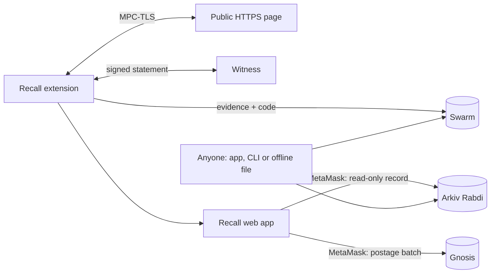

# Recall

**Proof of what a public web page or GitHub repo said, and a copy of it that can't be taken down.**

Recall captures a public HTTPS page or GitHub repository through a TLSNotary witness, stores the
signed evidence (and the code) on **Swarm**, and indexes it on **Arkiv**. Anyone can check a capture
in their own browser, even offline, without trusting the person who made it or us.

Built from scratch at **ETHGlobal Mumbai 2026**.

| | |
|---|---|
| **Demo video (3 min)** | <https://drive.google.com/file/d/1ZxGArPliJmzQaDDs9xogtd27HKMYTKiz/view> |
| **Web app** | <https://localhostwastaken.github.io/Recall/app/> |
| **Web app on Swarm** | <https://recallapp.eth.limo> · <https://recallapp.bzz.link> |
| **Extension** | `recall-extension.zip` in the [v0.1.0-mumbai release](https://github.com/localhostwastaken/Recall/releases/tag/v0.1.0-mumbai) |
| **Prize tracks** | EF **Best CROPS App** · Arkiv **Build on Arkiv (from scratch)** · **Arkiv + Swarm bonus** |

---

## Why

In July 2026 the Indian government ordered GitHub to block the
[bitchat](https://github.com/permissionlesstech/bitchat) repositories within three hours. bitchat is an
open-source messaging app that works over Bluetooth, with no internet. The stated reason: people could
use it during internet shutdowns, and it is hard to intercept. That is censorship: a tool blocked
because it keeps people connected when the state cuts them off.

Once code or a page is blocked, people can't get it, and nobody can prove what it was. Screenshots can
be faked, and archives ask you to trust them. Recall fixes both: it keeps **verifiable proof** of
exactly what was served, and keeps the **content itself** reachable on Swarm.
Sources: [CyberInsider](https://cyberinsider.com/github-ordered-to-remove-decentralized-messaging-app-bitchat-in-india/),
[The Cyber Sec Guru](https://thecybersecguru.com/news/india-github-bitchat-repository-takedown/).

## Try it in one minute (no install, no wallet)

Our live capture of the bitchat repository:

- **In the app** (checks run in your browser):
  <https://localhostwastaken.github.io/Recall/app/#/c/0xf1abb5b79f48ed9fcb54c1981ac9e81f87e26b09f93f65516ad8609e5cce5caf>
- **The same record in Arkiv's own explorer:**
  <https://rabdi.explorer.arkiv.network/entity/0xf1abb5b79f48ed9fcb54c1981ac9e81f87e26b09f93f65516ad8609e5cce5caf>
- **The evidence file from Swarm's public gateway** (drop it on the app's home page; it verifies offline):
  <https://download.gateway.ethswarm.org/bytes/2bdf1df434d449aa4c35bf84709467dab0c1057a229564e5bb2b6cf2b67f0fcc>
- **The public library** of every capture, ranked by time kept alive:
  <https://localhostwastaken.github.io/Recall/app/#/library>

## How it works

1. **Capture.** The Recall browser extension fetches the page over TLS together with a **witness**
   (TLSNotary MPC-TLS). The witness signs (EIP-712) hashes of exactly what the server sent. Requests
   carry no cookies or login. For a GitHub repo, Recall also downloads the code and checks its git tree
   hash against the commit GitHub reported.
2. **Store.** The signed evidence file and the code go to **Swarm**, stamped in your browser with a
   postage batch you bought.
3. **Index.** A small read-only record (page, body hash, witness, time, Swarm reference) goes to
   **Arkiv**, written from your own MetaMask. Buy storage once, then each capture is one confirmation.
4. **Verify.** The web app finds every capture of a URL on Arkiv, downloads the evidence from any Swarm
   gateway, recomputes the Swarm hash and re-runs every check itself:
   **A** bytes match the signed hashes, **B** request and response are well-formed,
   **C** signed by a witness you trust. Versions show as a timeline with a diff.
5. **Keep alive.** Anyone, not only the capturer, can pay to extend a capture's Swarm storage and
   Arkiv record.



## Prize eligibility

### EF: Best CROPS App

| Requirement | Where |
|---|---|
| Public repo, free and open-source licence | MIT, [LICENSE](LICENSE) |
| README a judge can run it from | [Run it](#run-it) |
| A section titled CROPS, one or two lines per letter | [CROPS](#crops) |
| Demo video, 3 minutes max, lead property end to end | [Demo video](https://drive.google.com/file/d/1ZxGArPliJmzQaDDs9xogtd27HKMYTKiz/view) |
| No third-party trackers or analytics in the client | None: no analytics, no trackers |
| Keys and personal data stay on the user's device | MetaMask and the extension's stamp key stay local; see [CROPS](#crops) |

### Arkiv: Build on Arkiv (from scratch)

| Requirement | Where |
|---|---|
| Built from scratch at ETHGlobal Mumbai | Yes (vendored TLSNotary code is noted under [Credits](#licence-and-credits)) |
| Writes to Arkiv's current testnet with `@arkiv-network/sdk`, and a feature users see reads it | Writes: [`packages/net/src/arkiv.ts`](packages/net/src/arkiv.ts). Reads: the library, timeline and capture pages |
| Writer wallet address(es) and one query we can run | [Writer wallets](#writer-wallets) |
| `arkiv/schema.md` and `arkiv/friction.md` | [schema](arkiv/schema.md), [friction](arkiv/friction.md) |
| One file per judging criterion | [reach](arkiv/reach.md), [why Arkiv](arkiv/why-arkiv.md), [how we use Arkiv](arkiv/how-you-use-arkiv.md) |
| Open-source licence, and how we used AI | [LICENSE](LICENSE), [AI use](#ai-use) |

### Arkiv + Swarm bonus

Everything the bonus asks for is in [arkiv/swarm.md](arkiv/swarm.md): what lives on Swarm and on Arkiv,
the entity field holding the Swarm reference (`evidenceRef`), an entity key with its Swarm reference,
the postage batch and the wallet that bought it, the upload and read code, and steps to run one upload
and one read. In the demo video, Swarm is used at the publish step (evidence and code uploaded) and when
the record is checked.

## CROPS

Recall's lead property is **censorship resistance**: once a page or repo is captured, nothing we run is
needed to find it, fetch it or check it.

- **C: censorship resistant.** We run the witness (needed only for new captures; anyone can run their
  own from [`witness/`](witness/), and readers choose which witness keys to trust) and the GitHub Pages
  copy of the app. If either disappears, existing captures still load and verify from Arkiv, Swarm, the
  copy of the app hosted on Swarm, or a downloaded evidence file, for as long as their storage is paid.
- **O: open source.** MIT. The extension, witness, web app, scripts and a full local devnet all build
  and run from this repo alone.
- **P: private.** No analytics or trackers. Captures send no cookies or login. The witness sees the
  captured page and your IP; the Arkiv RPC, Swarm gateways and Gnosis RPC see your IP and what you
  request. A record is public and names the wallet that wrote it, so use a fresh wallet if that matters.
- **S: secure.** Keys stay on your device (MetaMask, and the extension's stamp key). Gateways and RPCs
  can withhold data but not forge it: every view recomputes the Swarm hash and re-runs the checks in
  the browser. Trust assumptions: the witness you pin; TLSNotary alpha.15 is unaudited.

## Writer wallets

All entities were written on **Arkiv Rabdi** (chain ID 7794095):

| Wallet | Role | Writes |
|---|---|---|
| `0xd46480d1Ec02B8ce92aE383914026efD5F73f835` | Our capturer wallet in live runs (MetaMask) | `recall.v1.capture` and `recall.v1.attachment` records |
| `0xC9319e18e86cd7EB653c0Ed0693c0cf5B63db37D` | The Recall witness | `recall.v1.witness` profile; also signs every capture (EIP-712) |

In the product, anyone who captures writes records from their own wallet. Records are created
**read-only** and **permissionlessly extendable**.

**Query the bitchat capture** (public endpoint, no key needed):

```bash
curl -s https://rpc.rabdi.db-chain.testnet.arkiv.network -H 'content-type: application/json' --data '{"jsonrpc":"2.0","id":1,"method":"arkiv_query","params":["arkiv.schema = str('"'"'recall.v1.capture'"'"') AND urlHash = key(0x4859353fd58b4c32f71b336b8a28b80a4b4375500f0e45dc4444aab70881b0af)",{"select":{"key":true,"owner":true,"creator":true,"expiresAt":true,"creationFlags":true,"attributes":{"evidenceRef":true,"batchId":true,"signedAt":true}},"limit":"0x5"}]}'
```

It returns entity `0xf1abb5b7…5cae` with `"readonly":true` and its Swarm `evidenceRef`.

**Or query and verify with our CLI:** `pnpm install && pnpm arkiv:query` lists a page's captures from
Arkiv, downloads each evidence file from Swarm and re-runs checks A to C.

## Run it

**Needs:** Node 22, pnpm 10 (`corepack enable`), Docker, Chrome or Chromium. For live captures:
MetaMask, a little tGLM on Arkiv Rabdi ([faucet](https://hub.arkiv.network/faucet)), and xBZZ plus a
little xDAI on Gnosis.

**Use the live extension**

1. Download `recall-extension.zip` from the
   [release](https://github.com/localhostwastaken/Recall/releases/tag/v0.1.0-mumbai), unzip it, open
   `chrome://extensions`, turn on Developer mode, click **Load unpacked** and pick the folder. Nothing
   to configure: the release always has the ID `mgpclfpdgpinofgpgfeodcbmlfaglmnp`.
2. In the [web app](https://localhostwastaken.github.io/Recall/app/), open **Storage** and buy one or
   more batches (about 0.32 xBZZ each for 7 days).
3. Open a public page or GitHub repo, click the Recall icon, then **Capture this page** (or
   **Capture this repository**).
4. In the tab that opens, click **Upload and publish** and confirm once in MetaMask.

No xBZZ? Pick **Use free storage instead** on the publish page (the Swarm gateway stores it, but nobody
can extend it). On Brave, set `brave://settings/web3` > Default Ethereum wallet to "Extensions (no
fallback)".

**Run everything locally**

```bash
pnpm install
pnpm devnet:up         # local Arkiv node, Gnosis fork, 3 Bee nodes, a test site and a witness
pnpm test              # unit tests
pnpm test:e2e          # Playwright: extension + app end to end (mock MetaMask)
pnpm --filter web dev  # the web app against the devnet
pnpm devnet:down
```

More: [devnet/README.md](devnet/README.md). Run your own witness: [witness/README.md](witness/README.md).

## Project structure

| Path | What it is |
|---|---|
| `extension/` | Fork of [tlsn-extension](https://github.com/tlsnotary/tlsn-extension): capture popup, stamp key, Swarm upload |
| `witness/` | TLSNotary verifier server plus Recall's checks and EIP-712 signing |
| `packages/evidence/` | Evidence format, transcript parsing and checks A to D |
| `packages/net/` | Arkiv entities and queries, Swarm stamping and download, Gnosis postage batches |
| `apps/web/` | The web app: library, verify, publish, storage, keep-alive. Static, no backend |
| `arkiv/` | Arkiv and Swarm prize docs |
| `docs/` | Design, plan and the log of every live value we measured |

## Limitations

- **One witness by default.** New captures need a witness (ours, or one you run). Verification never does.
- **Unaudited.** TLSNotary `v0.1.0-alpha.15` and our signing patch have not been audited.
- **TLS 1.2 only, about 64 KB per page, static HTML only.** Pages built by JavaScript capture nearly empty.
- **Repos:** archives over 25 MB, submodules and `.gitattributes` export rules are refused.
- **About 77 MB of upload per capture** for the MPC setup; slow connections time out.
- **Testnet.** The Arkiv index is on Rabdi, a testnet. Swarm and Gnosis are mainnet.
- **Storage lasts while someone pays.** Batches and records expire unless someone uses Keep alive.
- **A record's batch ID is not cryptographically bound to its evidence.** Keep alive checks the batch
  exists and has Recall's shape, and the library prefers the record written first.
- **Read-only, not undeletable.** Nobody can change a record, but its owner can still delete it.
- **Developer-mode install.** The extension is not in the Chrome Web Store yet.
- Not legal-grade proof. Public pages only (no logins, no cookies).

## AI use

We used AI coding assistants to help write code and tests. All product and design decisions were the
team's, and are recorded in the spec and plan in [docs/superpowers/](docs/superpowers/).

## Licence and credits

MIT, see [LICENSE](LICENSE).

Recall builds on [TLSNotary](https://tlsnotary.org): the extension is a fork of
[tlsn-extension](https://github.com/tlsnotary/tlsn-extension) and the witness is its verifier server,
both MIT / Apache-2.0. Their notices and our changes are in [extension/NOTICE](extension/NOTICE) and
[witness/NOTICE](witness/NOTICE). Storage on [Swarm](https://www.ethswarm.org), index on
[Arkiv](https://arkiv.network).
