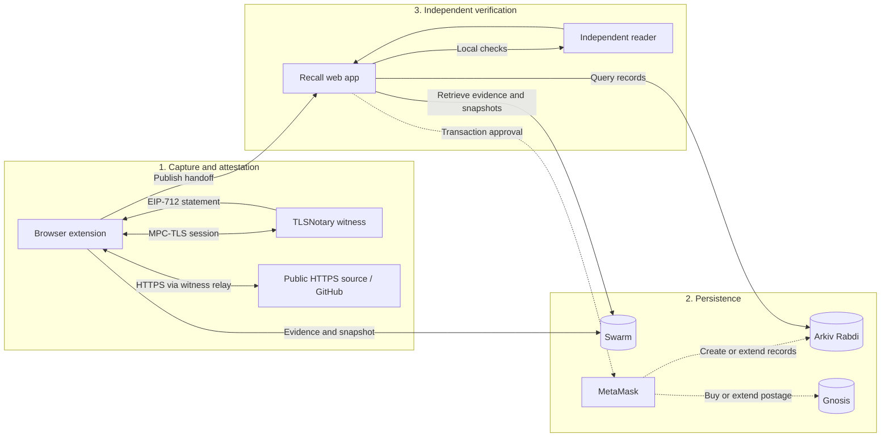

# Recall

**Preserve what the web served. Verify it for yourself.**

Recall is an open-source archive for public HTTPS responses and GitHub repository snapshots. A TLSNotary witness attests to the captured HTTPS exchange and signs a statement about it. Swarm stores the evidence and repository snapshots, while Arkiv indexes the records. Readers can retrieve the evidence and verify it in a browser against a witness they trust.

Built at **ETHGlobal Mumbai 2026** · **Ethereum Foundation – Best CROPS App: Censorship Resistant, Open Source, Private, Secure, 2nd place** · Arkiv Build on Arkiv (from scratch) · Arkiv + Swarm bonus

[Open the app](https://localhostwastaken.github.io/Recall/app/) · [Watch the demo](https://drive.google.com/file/d/1ZxGArPliJmzQaDDs9xogtd27HKMYTKiz/view) · [Source code](https://github.com/localhostwastaken/Recall) · [Extension release](https://github.com/localhostwastaken/Recall/releases/tag/v0.1.0-mumbai) · [ETHGlobal showcase](https://ethglobal.com/showcase/recall-7r8ye)

Also hosted on Swarm: [eth.limo](https://recallapp.eth.limo) · [bzz.link](https://recallapp.bzz.link). Built with [TLSNotary](https://tlsnotary.org), [Swarm](https://www.ethswarm.org), [Arkiv](https://arkiv.network), and [MetaMask](https://metamask.io).

## Recognition and awards

At [ETHGlobal Mumbai 2026](https://ethglobal.com/showcase/recall-7r8ye), Recall received:

- **Ethereum Foundation:** Best CROPS App: Censorship Resistant, Open Source, Private, Secure — 2nd place.
- **Arkiv:** Build on Arkiv (from scratch).
- **Arkiv + Swarm:** bonus.

## Product preview

Try the [public library](https://localhostwastaken.github.io/Recall/app/#/library) or open the [bitchat capture](https://localhostwastaken.github.io/Recall/app/#/c/0xf1abb5b79f48ed9fcb54c1981ac9e81f87e26b09f93f65516ad8609e5cce5caf) to inspect its checks. These examples depend on the availability of their testnet records and stored evidence. The [demo video](https://drive.google.com/file/d/1ZxGArPliJmzQaDDs9xogtd27HKMYTKiz/view) shows the workflow.

## The problem

Public information and open-source code can become inaccessible through takedowns, censorship, or changes to the original service. In July 2026, Indian authorities directed GitHub to disable access to repositories associated with [bitchat](https://github.com/permissionlesstech/bitchat), a Bluetooth mesh messaging application. Reports describe a three-hour deadline and cite the authorities' concerns about interception and communication during internet shutdowns ([CyberInsider](https://cyberinsider.com/github-ordered-to-remove-decentralized-messaging-app-bitchat-in-india/), [The Cyber Sec Guru](https://thecybersecguru.com/news/india-github-bitchat-repository-takedown/)).

A screenshot or ordinary archive can preserve a copy, but a reader must decide whether to trust its creator or operator about what the server returned. Recall pairs a stored copy with a witness-signed account of the HTTPS exchange. This helps readers check the evidence against a witness they trust; it does not establish that the server's content was truthful or guarantee that a copy remains available.

## How Recall works

1. **Capture:** The extension requests a supported public HTTPS response through a TLSNotary MPC-TLS session with a witness. For a GitHub repository, it captures GitHub's branch response and downloads a snapshot of the indicated commit.
2. **Attest:** The witness verifies the session and signs an EIP-712 statement about the revealed transcript. The evidence file contains the statement, signature, and transcript.
3. **Store:** Evidence and any repository snapshot are uploaded to Swarm, using a postage batch or the free gateway option.
4. **Index:** The user approves an Arkiv record through MetaMask. The record points to the evidence and includes searchable capture metadata.
5. **Retrieve and verify:** A reader finds a record on Arkiv, retrieves evidence from Swarm, and checks it in the browser. A downloaded evidence file can be verified offline after loading the verification client and its required dependencies. Verification checks the transcript against the witness-signed statement; it does not independently recreate or verify the original TLS session.
6. **Keep alive:** Anyone can pay to extend an eligible postage batch and Arkiv record. Free gateway storage cannot be extended this way.

## Architecture



Solid arrows show data or verification flow; dotted arrows show wallet approvals and transactions.

**Trust model:** A reader can check saved evidence without the capturer or Recall's hosted app, using a trusted verification client and its loaded dependencies. The reader must trust the chosen witness to have checked the TLSNotary session and protected its signing key: the browser checks the signed statement and transcript, not the original session. Online discovery and retrieval depend on Arkiv and Swarm; RPCs and gateways can withhold data. For stamped uploads, content addressing checks the Swarm reference; signature checks and comparisons with the record provide additional integrity checks, subject to the cryptographic and software assumptions.

## Technical implementation

### TLSNotary capture and witness verification

The extension and witness use TLSNotary MPC-TLS. The witness requires a proven server identity and a fully revealed transcript, rejects proxy mode and partial reveals, and applies HTTP and request-header gates before signing. Captures use a public GET without cookies or authorization. See [witness configuration and gates](witness/README.md) and [capture code](extension/packages/extension/src/recall/capture.ts).

### Cryptographic evidence and integrity checks

The witness signs a typed EIP-712 `Capture` statement containing transcript lengths and SHA-256 hashes. The reader checks **A**: transcript lengths and hashes; **B**: request, response, server name, and framing; **C**: signature and the reader's pinned witness; and optionally **D**: a local file's hash against the captured response body. An unknown but valid signer produces a warning. See [checks](packages/evidence/src/checks.ts) and [statement](packages/evidence/src/statement.ts).

### GitHub repository integrity verification

For a repository, Recall witnesses GitHub's branch API response, which identifies a commit and root tree. It downloads the commit archive and recomputes its Git tree ID from the files, modes, and paths, comparing it with the witnessed tree ID. This ties the snapshot to GitHub's response under Git's SHA-1 tree construction; the archive download itself is not the witnessed TLS transcript. See [Git verification](packages/evidence/src/git.ts).

### Swarm storage and content addressing

Evidence and repository archives are stored separately on Swarm. For stamped uploads, the client recomputes the Swarm root of downloaded content. Free gateway uploads skip that root check; evidence signatures and repository integrity checks still apply. The free option has different availability and extension properties. See [Swarm integration](packages/net/src/swarm.ts) and [storage details](arkiv/swarm.md).

### Arkiv entities and indexing

The shared [schema](packages/net/src/arkiv.ts) defines capture, confirmation, attachment, and witness entities. Capture records include a canonical URL hash, witness, body hash, time, batch ID, and evidence reference. Confirmations represent repeated captures with the same body. New entities are created read-only and permissionlessly extendable; their owners can still delete or transfer them. Older records may lack the read-only flag. See [schema and example records](arkiv/schema.md).

### Browser-side evidence verification

The static web app re-runs the evidence checks and compares verified facts with the Arkiv record, including URL hash, body hash, witness, and signing time. It can display a timeline and text diffs, compare a supplied file, and verify a repository snapshot. A mismatch or unavailable check is shown rather than silently treated as success. See [verification code](apps/web/src/verify/verify.ts).

### Permissionless storage extension

Keep alive lets a reader pay to extend a qualifying Swarm postage batch on Gnosis and an Arkiv entity. The batch ID in a record is not cryptographically bound to its evidence; the client checks that the batch exists and has Recall's expected shape. Extending either service is subject to its own transaction and limits. See [keep-alive flow](apps/web/src/keepalive/flow.ts).

## CROPS

- **C: censorship resistance.** Existing evidence can be retrieved and checked without Recall's witness or hosted app while the relevant data and a reader remain available. Anyone can run a witness for new captures; storage and records still expire without funding.
- **O: open source.** The extension, witness, app, packages, and local devnet are in this repository under the licences described below.
- **P: privacy.** The client has no analytics or trackers and capture requests omit cookies and login credentials. The witness sees the captured page and your IP; Arkiv RPCs, Swarm gateways, and Gnosis RPCs can see your IP and requests. Records are public and identify the writing wallet; use a fresh wallet if that matters. This is not anonymity.
- **S: security.** MetaMask keys and the extension's stamp key remain on the user's device. Readers check content and signatures locally, but must choose which witness keys to trust. TLSNotary alpha.15 and Recall's signing patch are unaudited.

## Try a live capture

| Requirement | Purpose |
| --- | --- |
| MetaMask | Approve transactions |
| tGLM on Arkiv Rabdi | Pay to publish Arkiv records ([faucet](https://hub.arkiv.network/faucet)) |
| xBZZ on Gnosis | Buy paid Swarm postage |
| xDAI on Gnosis | Pay Gnosis transaction fees for paid postage |

1. Download `recall-extension.zip` from the [release](https://github.com/localhostwastaken/Recall/releases/tag/v0.1.0-mumbai), unzip it, and use **Load unpacked** in `chrome://extensions` with Developer mode enabled. The release extension ID is `mgpclfpdgpinofgpgfeodcbmlfaglmnp`.
2. Open the [web app](https://localhostwastaken.github.io/Recall/app/). For paid storage, buy a batch under **Storage**; alternatively, choose the free gateway option when publishing.
3. Open a supported public page or GitHub repository and select the appropriate capture action in the extension.
4. In the publish tab, choose storage, select **Upload and publish**, and confirm the Arkiv transaction in MetaMask. The free storage option uses a gateway and cannot be extended.

On Brave, select **Extensions (no fallback)** as the default Ethereum wallet in `brave://settings/web3`. Fees and network availability can change.

## Run it

### Getting started: local development

**Prerequisites:** Node.js 22, pnpm 10 (the repository pins 10.20.0; enable Corepack), Docker with Compose, Bash and standard Unix tools, and Chrome or Chromium for extension tests. The devnet's first start builds images and can take several minutes; it uses local ports including 443. See [devnet/README.md](devnet/README.md) for services and requirements.

```bash
corepack enable
pnpm install
pnpm devnet:up
pnpm test
pnpm test:e2e
pnpm --filter web dev
```

Run the web server in a separate terminal as needed; it defaults to the local devnet. The local end-to-end suite uses Playwright and a mock wallet. Stop the devnet when finished:

```bash
pnpm devnet:down
```

The devnet includes an Arkiv node, Gnosis fork, three Bee nodes, HTTPS fixture, and witness with a public test key. Do not use that key for live captures. For network selection and endpoints, see [web defaults](apps/web/src/defaults.ts) and [devnet documentation](devnet/README.md).

**Environment:** Local devnet defaults do not require live credentials. For live scripts, [.env.example](.env.example) lists the optional or required values; use a gitignored `.env.local` as documented by the relevant script. `WITNESS_PRIVATE_KEY` is required to run your own witness. An Arkiv access key is optional for the public, rate-limited query endpoint. Never publish private keys.

**Independent witness:** With Rust installed, provide a 32-byte `WITNESS_PRIVATE_KEY` in the environment and run from `witness/`:

```bash
cargo run --release
```

The server defaults to port 7047. Configure a reachable endpoint and witness trust as appropriate; see [witness/README.md](witness/README.md) for configuration, deployment, and security gates.

## Project structure

| Path | Responsibility |
| --- | --- |
| [extension/](extension/) | TLSNotary extension fork, capture workflow, local stamp key, and uploads |
| [witness/](witness/) | TLSNotary verifier, capture gates, and EIP-712 signing |
| [packages/evidence/](packages/evidence/) | Evidence format, HTTP parsing, cryptographic checks, and Git tree verification |
| [packages/net/](packages/net/) | Arkiv schemas and queries, Swarm access, and postage batches |
| [apps/web/](apps/web/) | Static reader, library, publication, storage, and keep-alive UI |
| [devnet/](devnet/) and [e2e/](e2e/) | Local services and browser tests |
| [arkiv/](arkiv/) and [docs/](docs/) | Integration details, design, plans, and live evidence log |

## Limitations

- **Witness and audit:** New captures require a witness; the default is operated by the team. Readers choose trusted witness keys. TLSNotary `v0.1.0-alpha.15` and Recall's signing patch are unaudited. Verification of a saved file does not contact the witness.
- **Capture scope:** TLS 1.2 only; roughly 64 KB received per page; static response content only. JavaScript-rendered pages may capture nearly empty HTML. Only public requests without login or cookies are supported.
- **Repositories:** Archives over 25 MB, submodules, and `.gitattributes` export rules are refused. A snapshot is not a complete Git history.
- **Bandwidth:** MPC setup uploads about 77 MB per capture; slow connections can time out.
- **Availability:** Swarm batches and Arkiv records expire unless extended. Free gateway uploads cannot be kept alive through Recall. Owners can delete their records; older records may be mutable.
- **Batch binding:** The record's batch ID is not cryptographically bound to its evidence. Keep alive checks batch existence and shape; the library prefers the record written first.
- **Networks:** Arkiv Rabdi is a testnet; live Swarm and Gnosis use mainnet. Endpoints and records may become unavailable.
- **Installation:** The extension requires a developer-mode unpacked installation; it is not in the Chrome Web Store.
- **Evidence scope:** This is not legal-grade proof. A signed response establishes what a trusted witness attests the server returned, not whether the content was true or complete beyond the captured response.

## Network details and example records

The documented live writers on Arkiv Rabdi (chain ID 7794095) are capturer `0xd46480d1Ec02B8ce92aE383914026efD5F73f835` and witness `0xC9319e18e86cd7EB653c0Ed0693c0cf5B63db37D`. Users publish from their own wallets. After `pnpm install`, run `pnpm arkiv:query` to query the configured example and verify retrieved evidence; the endpoint and records must still be available. The [example capture in Arkiv's explorer](https://rabdi.explorer.arkiv.network/entity/0xf1abb5b79f48ed9fcb54c1981ac9e81f87e26b09f93f65516ad8609e5cce5caf) and its [Swarm evidence file](https://download.gateway.ethswarm.org/bytes/2bdf1df434d449aa4c35bf84709467dab0c1057a229564e5bb2b6cf2b67f0fcc) are also available when their backing services retain them.

Integration and judging details: [Arkiv reach](arkiv/reach.md), [why Arkiv](arkiv/why-arkiv.md), [how Recall uses Arkiv](arkiv/how-you-use-arkiv.md), [schema](arkiv/schema.md), [friction](arkiv/friction.md), and [Swarm bonus](arkiv/swarm.md).

## Licence and credits

Recall is MIT licensed; see [LICENSE](LICENSE). It builds on [TLSNotary](https://tlsnotary.org): the extension forks [tlsn-extension](https://github.com/tlsnotary/tlsn-extension), and the witness is based on its verifier server. Upstream MIT / Apache-2.0 notices and Recall's changes are documented in [extension/NOTICE](extension/NOTICE) and [witness/NOTICE](witness/NOTICE). Storage uses [Swarm](https://www.ethswarm.org), and indexing uses [Arkiv](https://arkiv.network).

## AI use

AI coding assistants helped write code and tests. Product and design decisions were the team's and are recorded in the specifications and plans in [docs/superpowers/](docs/superpowers/).

D7XVU8
